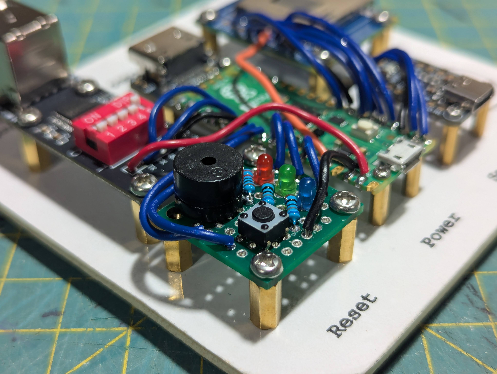
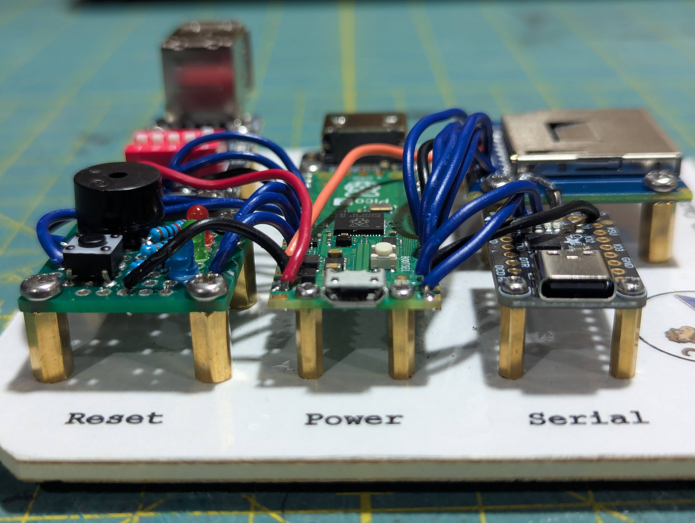

# Oasis32 — 32-bit RISC-V Retro-Inspired Computer

 

 

## Overview

**Oasis32** is a complete retro-inspired computer built around a Raspberry Pi Pico 2. It supports video, keyboard, mouse, removable SD card storage, serial I/O, and piezo audio, all accessible through memory-mapped interfaces with no complex protocols like USB. The result is a computer that can be programmed 100% from the ground up without third-party drivers, libraries, or SDKs, and can be understood top-to-bottom by a single person.

Oasis32 intentionally combines the simple architecture of a 1980s computer (single core, no threading, no memory protection) with modern affordances that make low-level assembly programming fun (32-bit RISC-V instruction set, 520KB of RAM, elegant syscall ABIs).

The goal is *not* to converge on mainstream standards like C, POSIX, UNIX, or FAT32. Instead, Oasis32 is a foundation for exploring a from-scratch homebrew software stack, including custom BIOS, OS, filesystem, tools, languages, and applications. It supports cross-assembling from modern hosts, but the long-term aspiration is a self-hosted machine that can be programmed entirely on its own.

## Features

* **Bare-Metal 32-Bit RISC-V Architecture**
  * Single-core Hazard3 RISC-V (RV32IMAC) processor running at 126 MHz
  * 464 KB of contiguous User SRAM plus 48 KB of directly accessible video RAM.
* **640×480 @ 60 Hz Monochrome HDMI Display**
  * Unified Graphics and text overlay (no mode switching)
  * 640x480 1bpp monochrome memory-mapped framebuffer for bitmap graphics
  * 80x60 memory-mapped character text buffer that overlays the bitmap graphics with bitwise `OR`
  * User-modifiable 256-glyph 8x8 memory-mapped font
  * Zero the text buffer for pure bitmap graphics, zero the framebuffer for pure text mode, or use both at the same time!
  * 16 16x16 hardware sprites, assignable to 56 memory-mapped animation/tile patterns
  * Sprites support horizontal and vertical flipping, three blending modes (opaque masked, bitwise OR, bitwise XOR), and can render above or below the text layer
  * Sprite zero conventionally used as a floating hardware mouse cursor
* **Peripheral access through stable `ecall` Syscall ABI**
  * Custom flash-resident BIOS isolates hardware details behind RISC-V `ecall` syscalls
  * **USB Keyboard & Mouse** (handled in silicon via a CH9350 HID-to-UART bridge—no software USB stack required)
  * **SD Card Storage** (raw 512-byte LBA block I/O with card-detect hot-swapping support)
  * **USB-C Serial Port** (presents to host PCs as a standard serial device usable from PuTTY or host scripts)
  * **Monotonic Microsecond Timer & VSYNC Frame Sync**
  * **Three User-Controllable Status LEDs** (Red, Green, Blue)
  * **Piezo Buzzer** (PWM tone generation)
* **Classic "Boot from Removable Disk" & Serial Development Workflow:**
  * **Boot from Removable SD Card:** No built-in OS—insert a card containing an `"OA32"` disk image and boot directly into demos, utilities, games, or a custom OS.
  * **Boot from Serial (RAM-Only):** Stream a Base64-encoded disk image over the USB-C serial port straight into RAM and execute immediately for rapid host-to-target iteration with zero SD card swapping or wear.
  * **Write SD Cards Over Serial:** Stream a Base64-encoded disk image over USB-C serial from the built-in boot menu to write persistent bootable SD cards directly on the machine.

## Documentation

*  For hardware details, see [Hardware](docs/Hardware.md).
*  For boot behavior, see [Booting Behavior](docs/BootBehavior.md).
*  For execution, interrupt, and `ecall` ABI design, see [Execution Model](docs/ExecutionModel.md).
*  For the Core 1 Video Coprocessor, framebuffer, and text overlay design, see [Video Architecture](docs/VideoArchitecture.md).
*  For the internal Flash and RAM layout, see [Memory Map](docs/MemoryMap.md).

## Development Status

Hardware has been designed, built, and tested with both
[C++](test_harness/cpp) and [RISC-V Assembly](test_harness/asm) test
harnesses. BIOS and ABI design are in progress.

For more detailed roadmap and status, see [Roadmap](ROADMAP.md).
