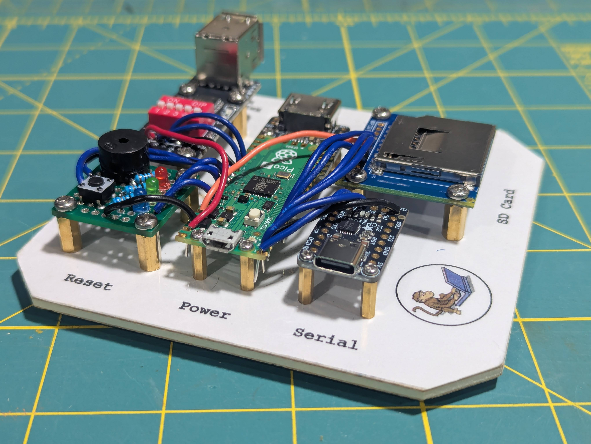

# Oasis32 — 32-bit RISC-V Retro-Inspired Computer

 

 

## Overview

**Oasis32** is a complete retro-inspired computer built around a Raspberry Pi Pico 2. It supports video, keyboard, mouse, removable SD card storage, serial I/O, and piezo audio, all accessible through memory-mapped interfaces with no complex protocols like USB. The result is a computer that can be programmed 100% from the ground up without third-party drivers, libraries, or SDKs, and can be understood top-to-bottom by a single person.

Oasis32 intentionally combines the simple architecture of a 1980s computer (single core, no threading, no memory protection) with modern affordances that make low-level assembly programming fun (32-bit RISC-V instruction set, 512KB of RAM, elegant syscall ABIs).

The goal is *not* to converge on mainstream standards like C, POSIX, UNIX, or FAT32. Instead, Oasis32 is a foundation for exploring a from-scratch homebrew software stack, including custom BIOS, OS, filesystem, tools, languages, and applications. It supports cross-assembling from modern hosts, but the long-term aspiration is a self-hosted machine that can be programmed entirely on its own.

## Features

* **Bare-Metal 32-Bit RISC-V Architecture**
  * Single-core Hazard3 RISC-V (RV32IMAC) processor running at 126 MHz
  * 464 KB of contiguous User SRAM plus 48 KB of directly accessible video RAM.
* **640×480 @ 60 Hz Monochrome HDMI Display**
  * Unified graphics and text overlay (no mode switching)
  * 640x480 1bpp monochrome memory-mapped framebuffer for bitmap graphics
  * 80x60 memory-mapped character text buffer that overlays the bitmap graphics with bitwise `OR`
  * User-modifiable 256-glyph 8x8 memory-mapped font (IBM Code Page 437 character set)
  * Optional non-destructive hardware blinking text cursor (inverts the active 8x8 cell on-the-fly without modifying the text buffer)
  * Zero the text buffer for pure bitmap graphics, zero the framebuffer for pure text mode, or use both at the same time!
  * 16 16x16 hardware sprites, assignable to 58 memory-mapped animation/tile patterns, each with its own opacity mask
  * Sprites support horizontal and vertical flipping, three blending modes (opaque, bitwise OR, bitwise XOR), and can render above or below the text layer
  * Sprite zero conventionally used as a customizable hardware mouse cursor
  * A second Hazard3 core acts as a dedicated video coprocessor driving all of the above with zero CPU overhead and no required synchronization on the main core.
* **Peripheral Access Through Stable `ecall` Syscall ABI**
  * Custom flash-resident BIOS isolates hardware details behind RISC-V `ecall` syscalls
  * **USB Keyboard & Mouse** events presented through simple syscalls (no software USB stack required), with hardware-independent keycodes, printable ASCII translation, and configurable timer-driven key repeat
  * **SD Card Storage** (raw 512-byte LBA block I/O with card-detect hot-swapping support)
  * **USB-C Serial Port** (presents to host PCs as a standard serial device for terminal emulators or host scripts)
  * **Text Console** (80×60 cursor positioning, character/string output with Unix newlines, line wrapping, auto-scrolling, manual up/down scroll, text clearing, and configurable hardware blinking cursor)
  * **Monotonic Microsecond Timer, VSYNC Frame Sync, Reset**
  * **Three User-Controllable Status LEDs** (Red, Green, Blue)
  * **Piezo Buzzer** (PWM tone generation)
* **Classic "Boot from Removable Disk" Vibe**
  * No built-in OS: insert an SD card containing a disk image to boot into demos, utilities, games, or a custom OS
* **Disk-image-over-serial for rapid development**
  * Cross-assemble an Oasis32 disk image on a modern machine, then send it over USB serial to:
    * Boot directly from the received disk image; OR
    * Write the received disk image to an SD card for future use
  
## Documentation
*  For a comprehensive programmer's reference, see [Programmer's Reference](docs/ProgrammersReference.md).
*  For hardware details, see [Hardware](docs/Hardware.md).
*  For boot behavior, see [Booting Behavior](docs/BootBehavior.md).
*  For execution, interrupt, and `ecall` ABI design, see [Execution Model](docs/ExecutionModel.md).
*  For the Core 1 Video Coprocessor, framebuffer, and text overlay design, see [Video Architecture](docs/VideoArchitecture.md).
*  For the internal Flash and RAM layout, see [Memory Map](docs/MemoryMap.md).

## Development Status

Hardware has been designed, built, and tested with both
[C++](test_harness/cpp) and [RISC-V Assembly](test_harness/asm) test
harnesses. BIOS and ABI implementation are in progress.

For more detailed roadmap and status, see [Roadmap](ROADMAP.md).
