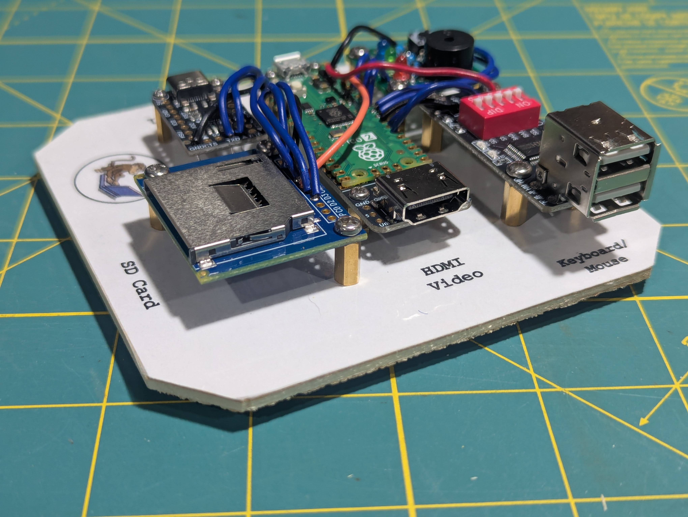

# Oasis32 — RISC-V Fantasy Retro Computer

## Overview

**Oasis32** is a 32-bit "fantasy retro" computer that combines the simple hardware interfaces
of 80's computers with modern affordances so that it's actually fun to program.

From retro computers, we get simple memory-mapped hardware that does not require third-party drivers, libraries, or SDKs. We also get a complete Programmers Reference Manual that fully
describes the behaviors and interfaces of the system for programmers.

From the modern age, we get the RISC-V instruction set, HDMI, SD Card removable storage, USB keyboard/mouse, and USB serial for talking to modern computers. The system has 520KB of
RAM, most of which is available to user code.

The result is a well-documented foundation that can be programmed from the ground up with zero third-party code. The goal is *not* to converge on existing standards such as C, Posix, UNIX, and FAT32, but rather to develop an "alternate history" tech stack that relies as little as possible on outside standards or libraries.

## Documentation

*  For hardware details, see [Hardware](docs/Hardware.md).
*  For boot behavior, see [Booting Behavior](docs/BootBehavior.md).
*  For execution, interrupt, and `ecall` ABI design, see [Execution Model](docs/ExecutionModel.md).
*  For the Core 1 Video Coprocessor, framebuffer, and text overlay design, see [Video Architecture](docs/VideoArchitecture.md).

## Development Status

Hardware has been designed, built, and tested with both
[C++](test_harness/cpp) and [RISC-V Assembly](test_harness/asm) test
harnesses. BIOS and ABI design are in progress.

For more detailed roadmap and status, see [Roadmap](ROADMAP.md).
